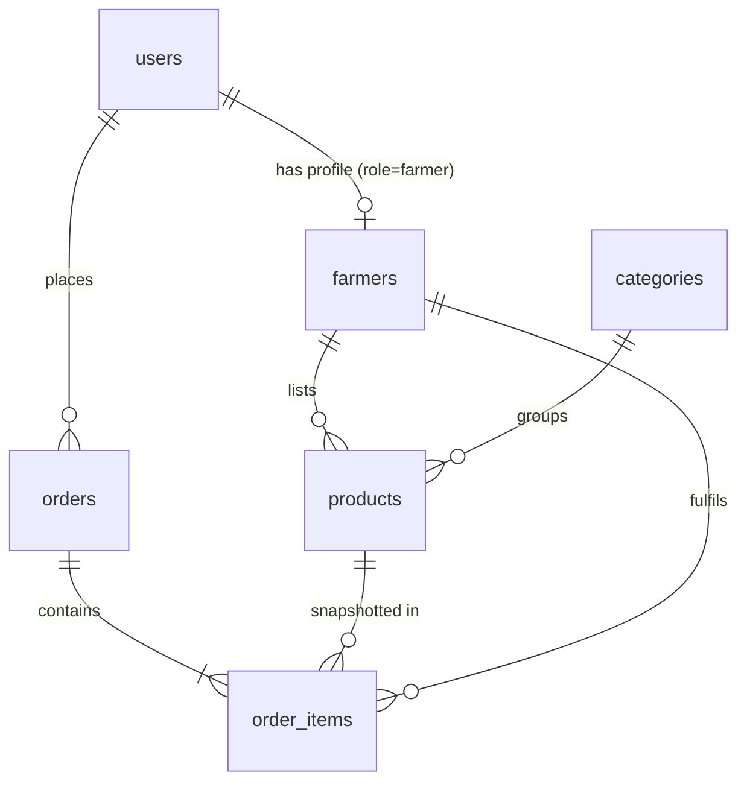

#  FredAgriMarket

**A farm-to-table online marketplace that connects Kenyan farmers directly with buyers.**

FredAgriMarket lets farmers list fresh produce, lets buyers browse, order and pay for it, and gives administrators the tools to verify farms and manage the platform, cutting out the middleman and the trip to the physical market.


---

## 📑 Table of Contents

- [Features](#-features)
- [Tech Stack](#-tech-stack)
- [Project Structure](#-project-structure)
- [Getting Started](#-getting-started)
- [Configuration](#-configuration)
- [Usage Guide](#-usage-guide)
- [JSON API](#-json-api)
- [Database Design](#-database-design)
- [Security](#-security)
- [Documentation](#-documentation)
- [Roadmap](#-roadmap)
- [Contributing](#-contributing)

---

## ✨ Features

### 🛒 For Buyers
- Browse the catalogue with **search, category filter, max-price slider, organic-only toggle and sorting** (price, rating)
- **Live search suggestions** in the header as you type
- Detailed product pages with farm information, stock levels and related produce
- Session-based **shopping cart** with quantity controls
- **Promo codes** (e.g. `ORGANIC10` for 10% off)
- Checkout with delivery address and a choice of **M-Pesa, Card or Cash on Delivery**
- Printable **order receipts** and an order history page
- Profile management and password change

### 👩‍🌾 For Farmers
- Self-registration as a farmer with farm name and location
- **Farmer dashboard** to add products, update price and stock inline, and remove listings
- View **recent sales** of your produce
- Public farmer directory and individual farm profile pages
- Verified-farm system: farms are approved by an admin before appearing publicly

### 🛡️ For Administrators
- **Admin panel** with live stats: users, orders, revenue and farms awaiting verification
- Tabbed management of **orders, farmers, products, users and contact messages**
- Update order status (pending → confirmed → delivered / cancelled)
- Verify or unverify farms, and show or hide products

### 🔧 Platform
- Stock is **locked and re-validated inside a database transaction** at checkout, so concurrent orders cannot oversell
- Order line items **snapshot name and price**, so receipts stay accurate even if a product is edited later
- Soft-deleted products preserve order history
- Fully responsive UI

---

## 🧰 Tech Stack

| Layer | Technology |
|-------|-----------|
| **Backend** | PHP 8.1+ (procedural, `strict_types`, PDO) |
| **Database** | MySQL 8 / MariaDB 10.4+ (InnoDB, utf8mb4) |
| **Frontend** | HTML, [Tailwind CSS](https://tailwindcss.com/) (CDN), vanilla JavaScript |
| **Icons & Fonts** | Font Awesome 6, Google Fonts (Inter) |
| **Sessions** | Native PHP sessions (HttpOnly, SameSite=Lax cookies) |

No framework, Composer, or build step is required.

---

##  Project Structure

```
fredagrimarket/
├── index.php              # Home page (hero, categories, featured produce)
├── catalogue.php          # Product listing with filters & sorting
├── product.php            # Product detail page
├── cart.php               # Shopping cart & promo codes
├── checkout.php           # Order placement (transactional)
├── receipt.php            # Printable order receipt
├── orders.php             # Buyer order history
├── farmers.php            # Farmer directory
├── farmer_profile.php     # Public farm profile
├── farmer.php             # Farmer dashboard
├── admin.php              # Admin panel
├── login.php / register.php / logout.php
├── profile.php            # Account settings
├── about.php / contact.php
├── setup_admin.php        # One-time admin creation (delete after use!)
├── config.php             # App settings & DB configuration
├── functions.php          # Shared helpers (DB, auth, CSRF, cart, search)
├── header.php / footer.php
├── api/
│   └── produce.php        # JSON endpoint for product search
├── assets/
│   ├── app.js             # Front-end behaviour
│   └── style.css          # Custom styles
├── database/
│   ├── schema.sql         # Database schema
│   └── seed.php           # Demo data (CLI only)
└── docs/
    ├── ERD.md             # Entity-relationship diagram
    └── WIREFRAMES.md      # Page wireframes
```

---

##  Getting Started

### Prerequisites

- **PHP 8.1 or newer** with the `pdo_mysql` extension
- **MySQL 8** or **MariaDB 10.4+**
- A web server (Apache/Nginx), or just PHP's built-in server for local development
- [XAMPP](https://www.apachefriends.org/), [Laragon](https://laragon.org/) or similar works well on Windows

### Installation

**1. Get the code**

```bash
git clone <your-repository-url> fredagrimarket
cd fredagrimarket
```

> Or extract the project zip into your web root (e.g. `htdocs/fredagrimarket`).

**2. Create the database**

```bash
mysql -u root -p < database/schema.sql
```

This creates the `fredagrimarket` database and all tables. (With XAMPP, you can instead import `database/schema.sql` through phpMyAdmin.)

**3. Configure the database connection** *(only if your credentials differ from the defaults)*

See [Configuration](#-configuration) below.

**4. Seed demo data** *(optional but recommended)*

```bash
php database/seed.php
```

This adds 6 product categories, 6 demo farms, 8 products and the `ORGANIC10` promo code.

**5. Start the app**

```bash
php -S localhost:8000
```

Open **http://localhost:8000** in your browser. (If using XAMPP/Apache, visit `http://localhost/fredagrimarket` instead.)

**6. Create the admin account**

Visit **http://localhost:8000/setup_admin.php**, fill in the form, and submit. The page locks itself once an admin exists.

> ⚠️ **Delete `setup_admin.php` from the server immediately after creating your admin account.**

---

## ⚙️ Configuration

Settings live in [`config.php`](config.php). Database values can be overridden with **environment variables**, which is recommended for production:

| Variable | Default | Description |
|----------|---------|-------------|
| `DB_HOST` | `127.0.0.1` | Database host |
| `DB_NAME` | `fredagrimarket` | Database name |
| `DB_USER` | `root` | Database user |
| `DB_PASS` | *(empty)* | Database password |

Example:

```bash
DB_USER=agri DB_PASS=secret php -S localhost:8000
```

Other constants in `config.php`:

| Constant | Default | Description |
|----------|---------|-------------|
| `APP_NAME` | `FredAgriMarket` | Brand name shown across the site |
| `DELIVERY_FEE` | `150` | Flat delivery fee in KES |

The default timezone is `Africa/Nairobi`.

---

## 📖 Usage Guide

### Demo accounts

After running the seed script, the six demo farmer accounts all use the password **`Farmer@123`**:

| Farm | Email |
|------|-------|
| GreenAcres Farm | `greenacres@example.com` |
| Limuru Organic Hub | `limuru@example.com` |
| Highland Orchards | `highland@example.com` |
| Rift Valley Apiaries | `apiaries@example.com` |
| Sunshine Poultry | `sunshine@example.com` |
| Mwea Co-op | `mwea@example.com` |

> 🔒 Change or remove these accounts before deploying to production.

### Typical workflows

**Buying produce**
1. Register a buyer account (or log in)
2. Browse **Produce**, filter or search, and add items to your cart
3. Optionally apply a promo code, then **Checkout**
4. Enter delivery details, pick a payment method and confirm
5. View your receipt, and track orders under **My Orders**

**Selling produce**
1. Register and choose the **Farmer** role (provide your farm location)
2. Wait for an administrator to verify your farm
3. Open the **Farmer Dashboard** to add products and manage stock and prices

**Administering the platform**
1. Log in with the admin account → **Admin Panel**
2. Verify new farms, move orders through their statuses, and moderate products

---

## 🔌 JSON API

### `GET /api/produce.php`

Returns active products as JSON. Powers the live search suggestions.

| Parameter | Type | Description |
|-----------|------|-------------|
| `q` | string | Search by product or farm name |
| `category` | string | Category slug (e.g. `vegetables`, `fruits`, `dairy-eggs`, `grains`, `honey`, `herbs`) |
| `max_price` | number | Maximum price in KES |
| `organic` | any | If set, only organic products |
| `sort` | string | `low-high`, `high-low`, or `rating` |
| `limit` | int | Results to return (1–50, default 20) |

**Example**

```bash
curl "http://localhost:8000/api/produce.php?category=fruits&organic=1&sort=rating&limit=5"
```

```json
{
  "count": 1,
  "data": [
    {
      "id": 3,
      "name": "Sweet Hass Avocados",
      "category": "Fruits",
      "farm": "Highland Orchards",
      "price": 150,
      "unit": "kg",
      "rating": 5,
      "organic": true,
      "stock": 100,
      "emoji": "🥑"
    }
  ]
}
```

Only `GET` is accepted; other methods return `405`.

---

## 🗄️ Database Design

The schema has **8 tables**: `users`, `farmers`, `categories`, `products`, `orders`, `order_items`, `promo_codes` and `contact_messages`.



Key design decisions:
- **Roles:** `buyer`, `farmer` and `admin` are stored on `users.role`
- **Order history is immutable:** `order_items` snapshots product name and unit price
- **Soft deletes:** products are deactivated (`is_active = 0`), not removed
- **Farm verification:** farmers need `is_verified = 1` (admin approval) to appear publicly

See [`docs/ERD.md`](docs/ERD.md) for the full diagram.

---

## 🔐 Security

- Passwords hashed with `password_hash()` / verified with `password_verify()`
- **CSRF tokens** on every state-changing form
- **Prepared statements** (PDO, emulation disabled) throughout, protecting against SQL injection
- Output escaping via a central `e()` helper, protecting against XSS
- Session ID regeneration on login; HttpOnly, SameSite and (on HTTPS) Secure cookies
- Role-based access control (`require_role()`) on dashboards and the admin panel
- Server-side recalculation of totals and stock re-validation at checkout
- Redirect targets restricted to same-site page names
- `seed.php` refuses to run outside the CLI

**Before going live:**
- Delete `setup_admin.php`
- Remove or change the demo farmer accounts
- Use a dedicated database user instead of `root`, with a strong password
- Serve the site over **HTTPS**

---

## 📚 Documentation

- [`docs/ERD.md`](docs/ERD.md): entity-relationship diagram and design notes
- [`docs/WIREFRAMES.md`](docs/WIREFRAMES.md): wireframes for every major page

---

## 🗺️ Roadmap

- [ ] Real payment integration (M-Pesa Daraja STK Push and card gateway). Payment methods are currently recorded on the order, but no payment is processed
- [ ] Email / SMS order notifications
- [ ] Product image uploads (emoji are used as placeholders today)
- [ ] Buyer product reviews and ratings
- [ ] Order tracking for farmers (fulfilment status per farm)

---

## 🤝 Contributing

Contributions are welcome!

1. Fork the repository
2. Create a feature branch: `git checkout -b feature/my-feature`
3. Commit your changes: `git commit -m "Add my feature"`
4. Push to the branch: `git push origin feature/my-feature`
5. Open a Pull Request

Please keep to the existing code style (strict types, prepared statements, escaped output).

---

## 📄 License

No license has been specified yet. Add a `LICENSE` file (for example [MIT](https://choosealicense.com/licenses/mit/)) to let others know how they may use this project.

---

<p align="center">Made with 💚 to support Kenyan farmers and fresh, local food.</p>
